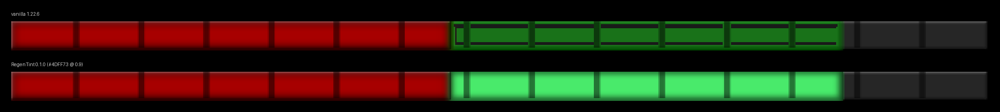

# RegenTint

While a bandage or poultice heals you over time, the health bar shows the health still to come as a green segment past the red. Vanilla draws that segment so faintly it's easy to miss. RegenTint draws it bright.



| | |
|---|---|
| modid | `lionfoxregentint` |
| version | 0.1.0 |
| game dependency | 1.22.0 (built and checked against 1.22.6) |
| type | code (C#), **client only**: goes in your own `Mods` folder, the server doesn't need it |

## Using it

Drop `lionfoxregentint_0.1.0.zip` into `%APPDATA%\VintagestoryData\Mods\` and restart the game.

The first time you enter a world it writes `%APPDATA%\VintagestoryData\ModConfig\lionfoxregentint.json`:

```json
{
  "Color": "#4DFF73",
  "Opacity": 0.9
}
```

- **Color** is the segment's fill as `#RRGGBB`. Its outline is the same colour at 40%, the rule vanilla uses for the red part.
- **Opacity** runs from 0 to 1. Vanilla uses 0.35.

Type `.regentint` in chat to reload the file and preview it: for five seconds the bar shows 45% health with healing to come up to 85%, then goes back to your real health. Only the drawing changes; your health is never touched.

## How it works

`GuiElementStatbar.ComposeValueOverlay` (in `VintagestoryAPI.dll`) draws the segment with two hardcoded colours, a fill of `(0, 1, 0)` and an outline of `(0, 0.5, 0)`, both at 35% opacity, and then blurs the bar. Over the dark trough that comes out a murky `(25, 114, 25)`. A Harmony transpiler replaces those eight constants with reads of static fields set from the config. The fields are read every time the bar is redrawn, so `.regentint` can reload the colour without re-patching.

The transpiler only patches if it finds exactly one copy of each colour call. If a game update moves them, it logs a warning and leaves the bar as vanilla rather than half-patching it.

The segment's length comes from the `futureHealth` attribute the server writes during heal-over-time. `HudStatbar` is the only thing that sets a future value, so the oxygen and saturation bars and modded bars (Hydrate or Diedrate's thirst bar, for one) share the class but are unaffected.

## Building

Needs a Vintage Story install, found through the `VINTAGE_STORY` environment variable or the usual install locations:

```
dotnet build -c Release
```

The build writes `lionfox_RegenTint.dll` to the repo root and a loadable zip to `build/`.

## Checking it without the game

`tests/RenderCheck` loads the installed `VintagestoryAPI.dll`, runs the real `ComposeValueOverlay` before and after applying the patch, and saves the drawn layers as PNGs in `tests/out/`. It exits non-zero if the transpiler didn't find both colour calls, so run it after a game update:

```
dotnet run -c Release --project tests/RenderCheck
```
